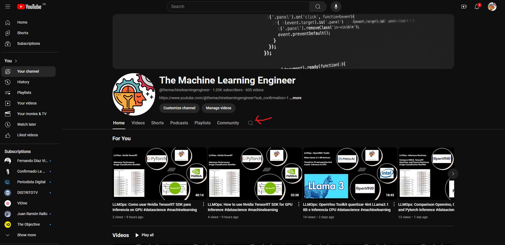
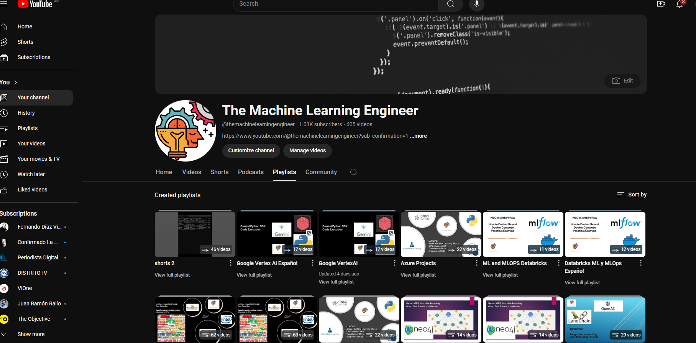

# LLM_Notebooks

This Repository contains all material supporting the Videos in my YouTube channel The Machine Learning Engineer https://www.youtube.com/channel/UCqAi1lTsd2wj7p05-Oos4ug

Look to the Playlist bellow to understand which kind of Material we have on the channel and here.
Note. I dont Attend issues i github. Please connect in youtube

The best way to find some information it is look for in the channel for a topic. There, if something matches what you are looking for, watch the video, and each of them contains a link to this repository on the description of the Video. Per Video I explain something, and we follow a Notebook or Code in VSCode. Python and C#, but mostly Python.
Videos are in English and Spanish. Each Video has the counterpart in the other Language, I think it is easy to differentiate just looking at the Title of the Video
Videos are classified in Playlists per topics, and each topic is very general. A video can fall in a couple of topics. 
Playlists are also organized in languages Spanish and English.
Shorts usually refer to a Video where it is described the complete topic. You can find the complete topic on the Section Related Video of the Short.

I upload Videos almost every day and the best way to solve a doubt or an issue it is to comment in the video. I try to answer as soon as I can. This I am doing a part of my job.

I will appreciate if you subscribe to the channel
https://www.youtube.com/@themachinelearningengineer?sub_confirmation=1
and like the videos and made constructive comments. Non-Constructive or unpolite comments are not answers and you can be banned.

Also, if you are don’t find something, let me know in a comment in YouTube and I will point you out to the video and Notebook or Code if I have it or something that may help you.

The videos and the notebooks in this repository are public. Shorts are not listed. Courses are lists. Open a list for the videos and the notebooks.

<!-- playlist-index -->

## Courses

- [Computer Vision](playlists/computer-vision.md) — 25 videos. [YouTube](https://www.youtube.com/playlist?list=PLw-i55H2Io6hmy_ZMPApeXmgWy2gzwzHt)
- [GDPR / PII Detection with Spacy](playlists/gdpr-pii-detection-with-spacy.md) — 1 video. [YouTube](https://www.youtube.com/playlist?list=PLw-i55H2Io6hpGHxRoz7qEdwiaHRe0ZVv)

## Playlists

- [Computer Vision](playlists/computer-vision-tpcmgy.md) — 4 videos. [YouTube](https://www.youtube.com/playlist?list=PLw-i55H2Io6hi1Prgpx3gJnoFXgtPcmgY)
- [Generative AI, LLM,s, Transformers, CV, NLP and more](playlists/generative-ai-llm-s-transformers-cv-nlp-and-more.md) — 212 videos. [YouTube](https://www.youtube.com/playlist?list=PLw-i55H2Io6hJTGshlRfNtcLOA1yoygzK)
- [Google ML and AI](playlists/google-ml-and-ai.md) — 22 videos. [YouTube](https://www.youtube.com/playlist?list=PLw-i55H2Io6gxfC3-WMveVWWIDCrJrNwP)
- [Langchain](playlists/langchain.md) — 51 videos. [YouTube](https://www.youtube.com/playlist?list=PLw-i55H2Io6gbrGi2oS7roT3DCztJXEfL)
- [LLamaIndex](playlists/llamaindex.md) — 6 videos. [YouTube](https://www.youtube.com/playlist?list=PLw-i55H2Io6gOk3aEaTowPsxqN3Xt_1Al)
- [Microsoft AI and ML Projects](playlists/microsoft-ai-and-ml-projects.md) — 27 videos. [YouTube](https://www.youtube.com/playlist?list=PLw-i55H2Io6iVKH_vcuhOe-yMR78L0goh)
- [ML and MLOPS Databricks](playlists/ml-and-mlops-databricks.md) — 10 videos. [YouTube](https://www.youtube.com/playlist?list=PLw-i55H2Io6ikqdDm78mFBhXLILcSnyA3)
- [ML projects](playlists/ml-projects.md) — 88 videos. [YouTube](https://www.youtube.com/playlist?list=PLw-i55H2Io6gFYNk4fr5I0aVaJDceYfsU)
- [ML Tricks](playlists/ml-tricks.md) — 27 videos. [YouTube](https://www.youtube.com/playlist?list=PLw-i55H2Io6iBclNnRAAe7DFnKn_0oWXJ)
- [MLOps](playlists/mlops.md) — 100 videos. [YouTube](https://www.youtube.com/playlist?list=PLw-i55H2Io6i7oaSoQSfMNGibiXtfr1Mn)
- [Neo4J Data Science](playlists/neo4j-data-science.md) — 15 videos. [YouTube](https://www.youtube.com/playlist?list=PLw-i55H2Io6iaqVkzFMR2H_sO-ZhiPl-A)
- [Other videos](playlists/other-videos.md) — 7 videos.
- [RAG Retrieval Augmented Generation](playlists/rag-retrieval-augmented-generation.md) — 27 videos. [YouTube](https://www.youtube.com/playlist?list=PLw-i55H2Io6g5GWsf9eoREhVVruhVHvGD)

## Courses in Spanish

- [Curso Computer Vision en Español](playlists/curso-computer-vision-en-espanol.md) — 23 videos. [YouTube](https://www.youtube.com/playlist?list=PLw-i55H2Io6hxvtTa2ePyjgdXstA51qNd)
- [GDPR/ PII Detection with Spacy (Español)](playlists/gdpr-pii-detection-with-spacy-espanol.md) — 1 video. [YouTube](https://www.youtube.com/playlist?list=PLw-i55H2Io6gpdsa4yTirgubJYQBESyUp)

## Playlists in Spanish

- [(Español) Computer Vision](playlists/espanol-computer-vision.md) — 3 videos. [YouTube](https://www.youtube.com/playlist?list=PLw-i55H2Io6j_BlGX7p55-Mj4VJGqCfjt)
- [(Español) Generative AI, LLM and Transformers, NLP, CV](playlists/espanol-generative-ai-llm-and-transformers-nlp-cv.md) — 209 videos. [YouTube](https://www.youtube.com/playlist?list=PLw-i55H2Io6iIJWAJcL9L6OHliT0omoyR)
- [(Español) Google Machine Learning e Inteligencia Artificial](playlists/espanol-google-machine-learning-e-inteligencia-artificial.md) — 22 videos. [YouTube](https://www.youtube.com/playlist?list=PLw-i55H2Io6iRYaSVsr85z0_eoB8Snt_-)
- [(Español) LlamaIndex](playlists/espanol-llamaindex.md) — 6 videos. [YouTube](https://www.youtube.com/playlist?list=PLw-i55H2Io6iUwtmeWXvXbQjLCbt-X6kz)
- [(Español) RAG Retrieval Augmented Generation](playlists/espanol-rag-retrieval-augmented-generation.md) — 27 videos. [YouTube](https://www.youtube.com/playlist?list=PLw-i55H2Io6iyzMKOYvIWhjkIHkhZhB7X)
- [Databricks ML y MLOps Español](playlists/databricks-ml-y-mlops-espanol.md) — 11 videos. [YouTube](https://www.youtube.com/playlist?list=PLw-i55H2Io6iO-RWANY7xuwm_PLqapTpG)
- [LangChain Español](playlists/langchain-espanol.md) — 50 videos. [YouTube](https://www.youtube.com/playlist?list=PLw-i55H2Io6giwdwBZKPtPGahLaJPdcj7)
- [Microsoft AI and ML Projects Español](playlists/microsoft-ai-and-ml-projects-espanol.md) — 29 videos. [YouTube](https://www.youtube.com/playlist?list=PLw-i55H2Io6glG7jrnHQduYRM-xzkLF2B)
- [ML projects Español](playlists/ml-projects-espanol.md) — 84 videos. [YouTube](https://www.youtube.com/playlist?list=PLw-i55H2Io6jNdsoeoEBw0BZX37pkLDO3)
- [MLOps Español](playlists/mlops-espanol.md) — 101 videos. [YouTube](https://www.youtube.com/playlist?list=PLw-i55H2Io6gNsGSZzje_z66PhYVnPag6)
- [Neo4J Español](playlists/neo4j-espanol.md) — 14 videos. [YouTube](https://www.youtube.com/playlist?list=PLw-i55H2Io6hVhLIKZYVXeCCKGyIrrBOM)
- [Otros videos](playlists/otros-videos.md) — 12 videos.

